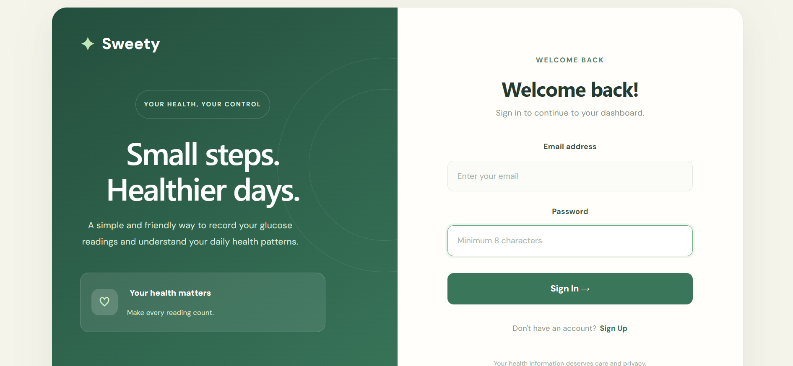
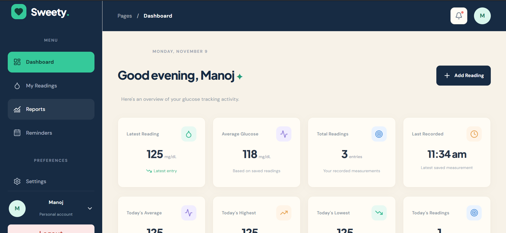
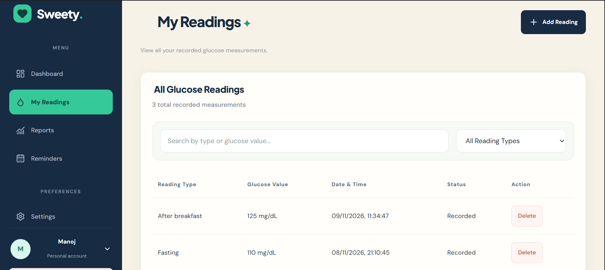
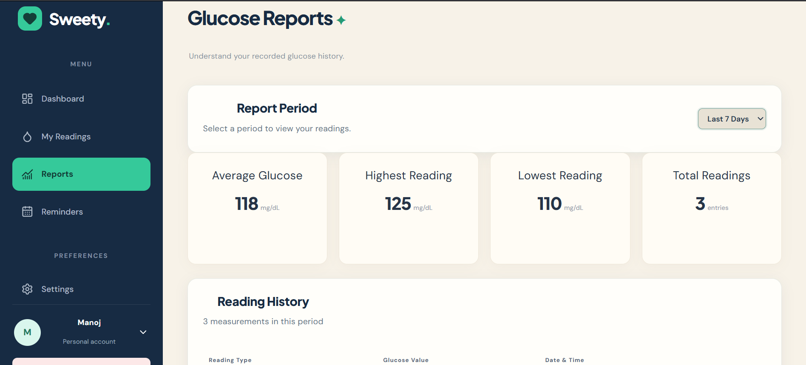
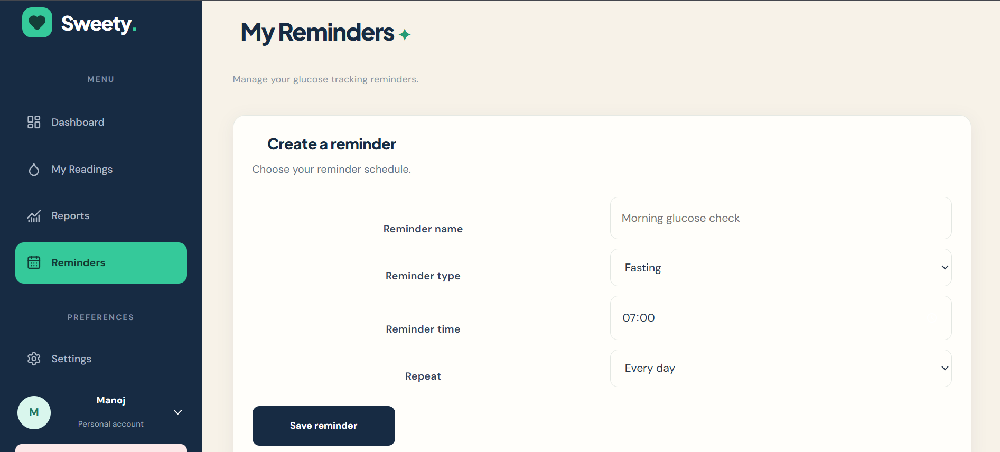

## Application Screenshots

### Registration Page


### Dashboard


### My Readings


### Reports


### Reminders



---

## Installation and Setup

### Prerequisites
- Node.js
- npm
- PostgreSQL

### 1. Clone the repository

```bash
git clone https://github.com/manojgowdav7-boop/sweety-blood-glucose-tracker.git
cd sweety-blood-glucose-tracker
```

### 2. Backend Setup

```bash
npm install
```

Create a `.env` file in the root directory with the following configuration:

```env
DB_HOST=localhost
DB_PORT=5432
DB_USER=your_postgres_username
DB_PASSWORD=your_postgres_password
DB_NAME=your_database_name
JWT_SECRET=your_secure_random_secret

Start the backend:

```bash
npm run dev
```

### 3. Frontend Setup

Open a second terminal:

```bash
cd client
npm install
npm run dev
```

### 4. Production Build

```bash
cd client
npm run build
```
